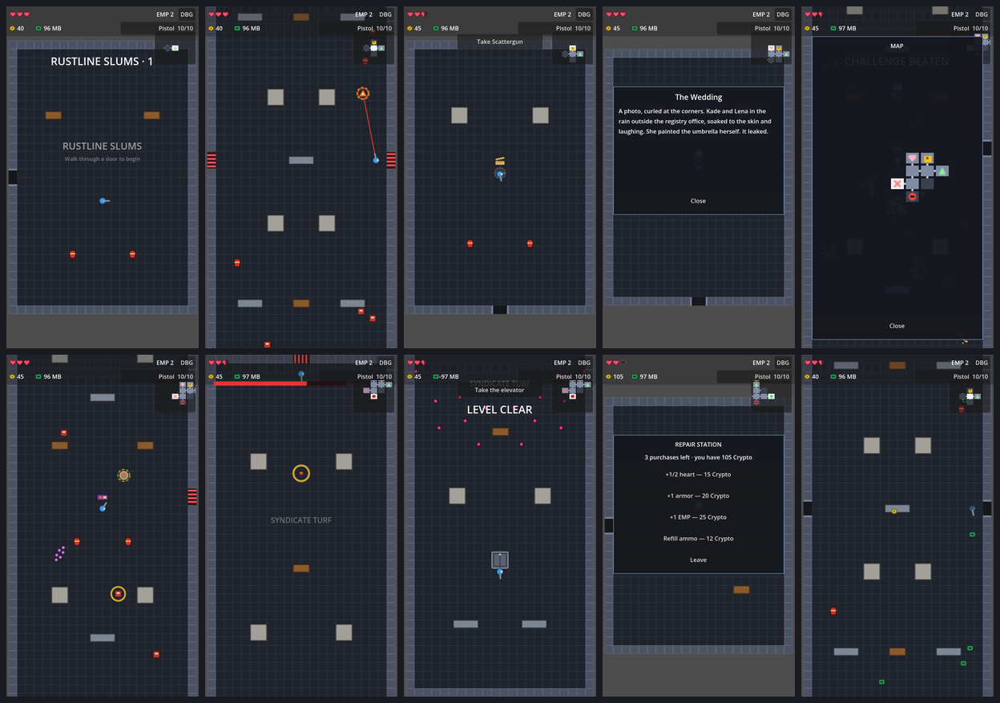

# Man vs AI

A one-finger, top-down roguelite shooter for Android (portrait), made with Godot 4.7.

> A grieving war veteran hunts the robot gang that murdered his family. Every implant that makes him strong enough
> to win replaces another piece of the man. There are three endings: stay human, become something in between, or become the machine.

**Status:** M3, levels, is built. Each level is generated from 8–9 greybox rooms: start, combat, chest, memory, challenge
arena, repair, terminal and a stand-in boss. Doors lock during fights, and an elevator after the boss leads to the next
level. It passes its automated tests. Playtests on real Android phones are still to do for M1–M3.

## Running the prototype
1. Open `project.godot` in Godot 4.7 and press **Play** (F5). The main scene is a generated level, `src/levels/level.tscn`.
   The older test rooms are still there: open `src/levels/test/combat_test.tscn` (the M2 endless arena) or
   `src/levels/test/controls_test.tscn` (the M1 controls room) and press **F6**.
2. On desktop, the mouse is the finger: hold the left button and drag in the lower 60% of the window.
3. Controls:
   - **Hold and drag:** run while auto-firing.
   - **Quick flick and release:** roll.
   - **Release near cover:** slide into cover.
   - **Double-tap:** EMP.
   - **Walk onto a gun on the floor and tap the prompt:** take it. The same prompt uses stations, shrines, consoles and the elevator.
   - **Tap the weapon card (top right):** swap between the pistol and the found gun.
   - **Walk into an open door:** go to the next room.
   - **Tap the minimap:** open the full map.
4. Tap **DBG** (top right) for the tuning panel: live gesture readout, A/B switches, threshold sliders and a
   300-bullet storm for performance checks.



**A level** (Rustline Slums, from `data/levels/level_1.tres`):
- **Combat rooms** lock their doors for 1–2 waves. Clearing one drops Crypto and sometimes a heart, ammo or armor.
- **Chest rooms:** touching the chest opens it and drops a gun.
- **The memory room:** Kade's first memory heals ½ heart.
- **Repair stations** sell hearts, armor, EMP charges and ammo for Crypto.
- **Hacked terminals** take RAM for a gamble.
- **The challenge arena** runs 3 waves for a Rare-or-better chest.
- **The boss room** holds a stand-in boss. Beating it reveals an elevator to a new level.
- Robots drop RAM. The hero respawns at the room's door 1.5 s after dying (until the lab arrives in M4).

**The M2 arena** (`combat_test.tscn`) runs endless, harder waves with three guns near the start. **The M1 controls
room** (`controls_test.tscn`) has target and shooter dummies for the control A/B tests.

All art is placeholder.

## Design documents
| Document | Contents |
|---|---|
| [Game Design Document](docs/GDD.md) | Vision, controls, combat, progression, levels, UX, monetization |
| [Narrative](docs/narrative.md) | World, characters, bosses, memory rooms, endings |
| [Content & balance](docs/content.md) | Weapons, implants, enemies, boss phases, economy tables |
| [Technical design](docs/technical.md) | Godot architecture, input, level generation, saves, Android |
| [Roadmap](docs/roadmap.md) | Milestones M0–M6 and their exit gates |
| [Open questions](docs/open-questions.md) | Pending decisions and design risks |

## Development principle: scene-first
This project is built **node-based**. Everything you can see, collide with or position (sprites, `Area2D`s, collision
shapes, markers, timers, UI) is a node in a `.tscn` scene built in the Godot editor. Scripts only add behavior to those
nodes and never build them in code. At runtime the game only makes copies of authored scenes (bullets, enemies, rooms).
The full rules and example scene trees are in [technical.md §0](docs/technical.md).

Before committing, run the checks from the repository root:
```bash
tools/check_scene_first.sh
```
```bash
godot --headless --path . --script res://tools/check_scenes.gd
```
```bash
godot --headless --path . --script res://tools/smoke_test_controls.gd
```
```bash
godot --headless --path . --script res://tools/smoke_test_combat.gd
```
```bash
godot --headless --path . --script res://tools/test_level_generator.gd
```
```bash
godot --headless --path . --script res://tools/smoke_test_level.gd
```

## Getting started
1. Install **Godot 4.7** (the standard build; the project uses GDScript only).
2. Open `project.godot`. The project uses the Compatibility renderer and a 360×640 portrait base resolution, and it
   emulates touch from the mouse so you can test on desktop.
3. For Android, install the Android export templates and SDK as described in the Godot docs, then add an Android export
   preset. Turn on the **VIBRATE** permission for haptics, and keep signing keystores out of the repository (they're gitignored).

## Project layout
```
assets/        art, audio, fonts (placeholders until the art direction is chosen)
data/          non-world .tres data: implants, level configs and waves, memories, weapon catalog, control thresholds
localization/  translation tables
src/           scenes and their scripts by feature (components, input, player, enemies, weapons, cover, levels, hub, ui…)
tools/         scene-first and scene-load checks, smoke tests, the level generator test
docs/          design documents (Godot skips this folder via .gdignore)
```
