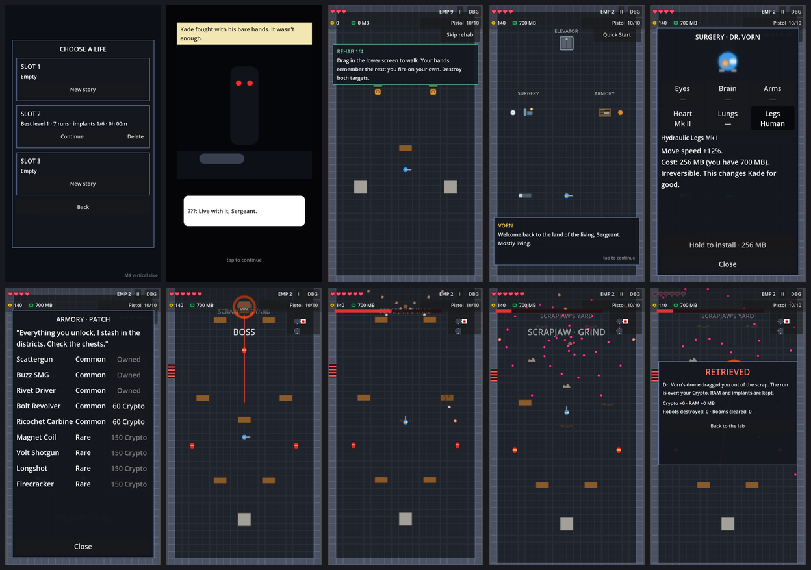
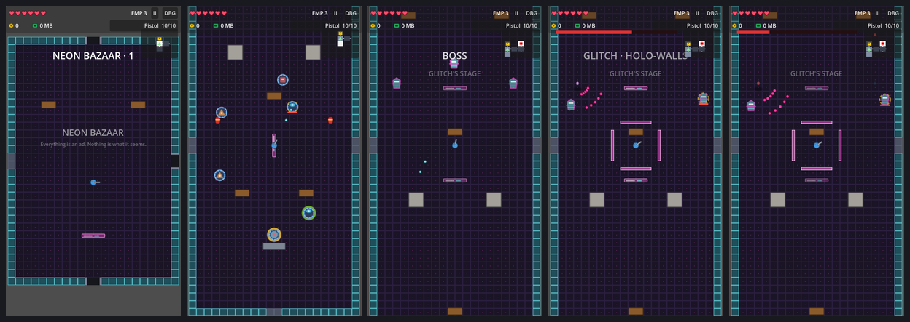
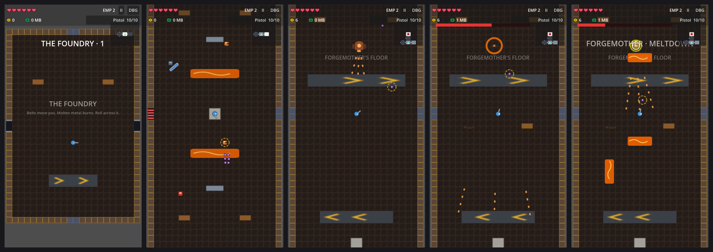
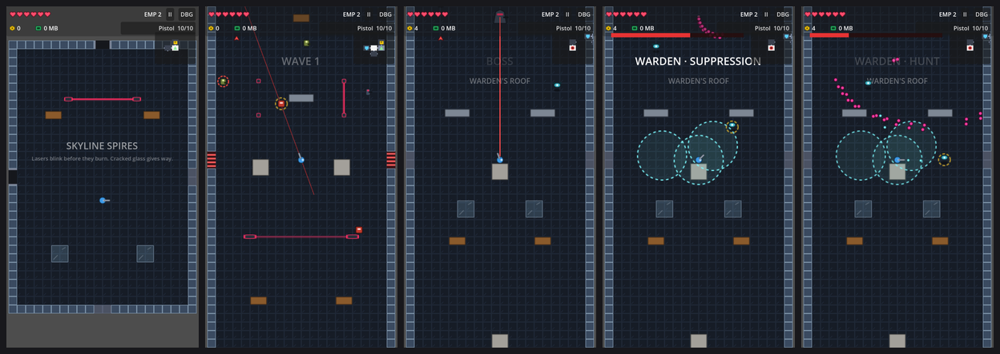
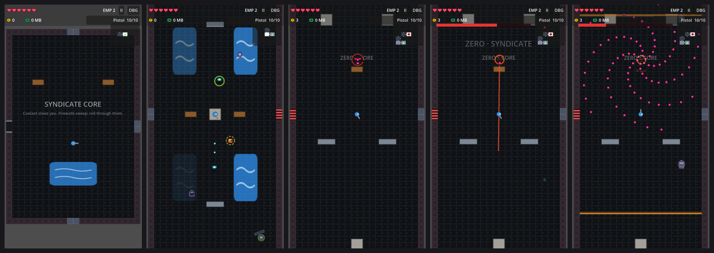
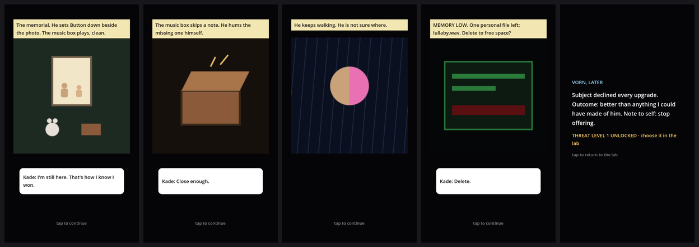

# Man vs AI

A one-finger, top-down roguelite shooter for Android (portrait), made with Godot 4.7.

> A grieving war veteran hunts the robot gang that murdered his family. Every implant that makes him strong enough
> to win replaces another piece of the man. There are three endings: stay human, become something in between, or become the machine.

**Status:** M5 (content) is nearly done: **the whole game is playable**, from the prologue to one of the endings.
A run goes Rustline Slums → lab → Neon Bazaar → lab → The Foundry → lab → Skyline Spires → lab → Syndicate Core.
Beating ZERO plays the ending for Kade's humanity band, then the credits; after that, NG+ threat levels unlock.
The balance pass is left.
- **Level 2, the Neon Bazaar:** holo-signs, Shotgunners, Drones, Hackers, elite robots and GLITCH.
- **Level 3, The Foundry:** conveyor belts, molten lanes, Grenadiers, Shield-bots and FORGEMOTHER.
- **Level 4, Skyline Spires:** laser grids, cracking glass, Snipers, EMP-bots and WARDEN, whose first kill unlocks
  Kade's old M7 Line Rifle.
- **Level 5, Syndicate Core:** coolant floods, firewalls, Null Knights and ZERO, who fights like the hero and then
  like every boss before him.
- Twelve more guns (all 21 now) and four more implants (Hawk Optics, Neural Coprocessor, Servo Arms, Filter Lungs): every body slot
  now has implants.

On top of the M4 vertical slice, on placeholder art:
- the full loop: three save slots, the prologue comic, a rehab tutorial, Dr. Vorn's lab, and Level 1 ending with SCRAPJAW;
- surgery with the Heart and Legs implants, and Patch's armory with six unlockable guns;
- auto-saving runs you can continue;
- generated placeholder sound and music.

It passes its automated tests. Playtests on real Android phones, the art-direction test and the real audio are still to do.

## Running the prototype
1. Open `project.godot` in Godot 4.7 and press **Play** (F5). The game starts on the title screen: tap **PLAY** and
   pick a save slot. A new story plays the prologue, then the rehab tutorial, then wakes you in the lab.
   To jump straight into a level, open `src/levels/level.tscn` and press **F6** (no save is written). The older test
   rooms are still there: `src/levels/test/combat_test.tscn` (the M2 endless arena) and `controls_test.tscn` (M1).
2. On desktop, the mouse is the finger: hold the left button and drag in the lower 60% of the window.
3. Controls:
   - **Hold and drag:** run while auto-firing.
   - **Quick flick and release:** roll.
   - **Release near cover:** slide into cover.
   - **Double-tap:** EMP.
   - **Walk onto a gun on the floor and tap the prompt:** take it. The same prompt uses stations, shrines, consoles and the elevator.
   - **Tap the weapon card (top right):** swap between the pistol and the found gun.
   - **Walk into an open door:** go to the next room.
   - **Tap the minimap:** open the full map.
   - **Tap II (top right):** pause, change the volumes, vibration and reduced flashing, or save and quit.
4. Tap **DBG** (top right) for the tuning panel: live gesture readout, A/B switches, threshold sliders and a
   300-bullet storm for performance checks.













**The lab** (between runs):
- **Surgery (Dr. Vorn):** spend RAM on implants for all six body slots (Heart, Legs, Eyes, Brain, Arms, Lungs),
  Mk I to Mk III. The first install in a body
  slot needs a 1.5 s hold, because implants can never be removed.
- **Armory (Patch):** spend Crypto to unlock guns; unlocked guns start turning up in chests.
- **Elevator or Quick Start:** start a run. Dying brings you back here, keeping Crypto, RAM and implants. Between
  levels of a run, the elevator continues to the next district; a new run starts at Level 1. After an ending, pick
  the next run's NG+ threat level under Quick Start.

**A level** (Rustline Slums, from `data/levels/level_1.tres`):
- **Combat rooms** lock their doors for 1–2 waves. Clearing one drops Crypto and sometimes a heart, ammo or armor.
- **Chest rooms:** touching the chest opens it and drops a gun.
- **The memory room:** Kade's first memory heals ½ heart.
- **Repair stations** sell hearts, armor, EMP charges and ammo for Crypto.
- **Hacked terminals** take RAM for a gamble.
- **The challenge arena** runs 3 waves for a Rare-or-better chest.
- **The boss room** holds SCRAPJAW: charges that plow through cover, a magnet that streams scrap and builds new cover,
  and a spinning grind. Beating him reveals the elevator back to the lab, and on to the Neon Bazaar.
- Robots drop RAM. Dying shows Dr. Vorn's Retrieved summary and returns you to the lab.

**The M2 arena** (`combat_test.tscn`) runs endless, harder waves with three guns near the start. **The M1 controls
room** (`controls_test.tscn`) has target and shooter dummies for the control A/B tests.

All art is placeholder.

## Design documents
| Document | Contents |
|---|---|
| [Game Design Document](docs/GDD.md) | Vision, controls, combat, progression, levels, UX, monetization |
| [Narrative](docs/narrative.md) | World, characters, bosses, memory rooms, endings |
| [Content & balance](docs/content.md) | Weapons, implants, enemies, boss phases, economy tables |
| [Technical design](docs/technical.md) | Godot architecture, input, level generation, saves, Android |
| [Roadmap](docs/roadmap.md) | Milestones M0–M6 and their exit gates |
| [Open questions](docs/open-questions.md) | Pending decisions and design risks |
| [Release material](docs/release/README.md) | Android build and signing, monetization setup, privacy policy, Play Console forms, store listing, testing tracks |

## Development principle: scene-first
This project is built **node-based**. Everything you can see, collide with or position (sprites, `Area2D`s, collision
shapes, markers, timers, UI) is a node in a `.tscn` scene built in the Godot editor. Scripts only add behavior to those
nodes and never build them in code. At runtime the game only makes copies of authored scenes (bullets, enemies, rooms).
The full rules and example scene trees are in [technical.md §0](docs/technical.md).

Before committing, run the checks from the repository root:
```bash
tools/check_scene_first.sh
```
```bash
godot --headless --path . --script res://tools/check_scenes.gd
```
```bash
godot --headless --path . --script res://tools/smoke_test_controls.gd
```
```bash
godot --headless --path . --script res://tools/smoke_test_combat.gd
```
```bash
godot --headless --path . --script res://tools/test_level_generator.gd
```
```bash
godot --headless --path . --script res://tools/smoke_test_level.gd
```
```bash
godot --headless --path . --script res://tools/smoke_test_m4.gd
```
```bash
godot --headless --path . --script res://tools/smoke_test_flow.gd
```
```bash
godot --headless --path . --script res://tools/smoke_test_l2.gd
```
```bash
godot --headless --path . --script res://tools/smoke_test_l3.gd
```
```bash
godot --headless --path . --script res://tools/smoke_test_l4.gd
```
```bash
godot --headless --path . --script res://tools/smoke_test_l5.gd
```
```bash
godot --headless --path . --script res://tools/smoke_test_endings.gd
```
```bash
godot --headless --path . --script res://tools/smoke_test_m6.gd
```
After changes that could cost frame time, also run the performance benchmark (machine-dependent, see
`docs/technical.md` §13):
```bash
godot --headless --fixed-fps 60 --path . --script res://tools/benchmark.gd
```

## Getting started
1. Install **Godot 4.7** (the standard build; the project uses GDScript only).
2. Open `project.godot`. The project uses the Compatibility renderer and a 360×640 portrait base resolution, and it
   emulates touch from the mouse so you can test on desktop.
3. For Android, follow [docs/release/android_build.md](docs/release/android_build.md): install the 4.7 export
   templates, the SDK and the Android build template, then use the **Android** preset in `export_presets.cfg`. Keep
   signing keystores out of the repository (they're gitignored).

## Project layout
```
assets/        art, audio, fonts (placeholders until the art direction is chosen)
data/          non-world .tres data: implants, level configs and waves, memories, dialogue, weapon catalog, control thresholds
localization/  translation tables
src/           scenes and their scripts by feature (components, input, player, enemies, weapons, cover, levels, hub, ui…)
tools/         scene-first and scene-load checks, smoke tests, the level generator test, the benchmark
docs/          design documents; docs/release/ has the Play Store material (Godot skips docs/ via .gdignore)
```
